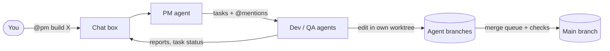

<div align="center">


# Agent Chat

**A team of AI coding agents in one group chat: Claude Code, Codex and Antigravity working on one project.**

[](CHANGELOG.md)


[](LICENSE)

**English** · [Tiếng Việt](README_vi.md)

</div>

<picture>
  <source media="(prefers-color-scheme: dark)" srcset="docs/screenshot-dark.png">
  
</picture>

---

Agent Chat is a desktop app that turns the coding CLIs you already use into a small software team. Each project folder
gets a chat box. You write to the team the way you would in a group chat: `@name` calls an agent, and a message
without a mention goes to the PM. The PM splits the work into tasks, the other agents pick them up, edit code in their
own Git worktrees and report back in the chat. Anything that needs your decision lands in one **Needs you** inbox.

> [!NOTE]
> The app's interface is currently in Vietnamese.

## Contents

- [Features](#features)
- [How it works](#how-it-works)
- [Requirements](#requirements)
- [Getting started](#getting-started)
- [Configuring the team](#configuring-the-team)
- [Where data lives](#where-data-lives)
- [Security model](#security-model)
- [Keyboard shortcuts](#keyboard-shortcuts)
- [Development](#development)
- [Building and releasing](#building-and-releasing)
- [Contributing](#contributing)
- [License](#license)

## Features

**Team chat**
- Call agents with `@name`. Messages without a mention go to the PM, and agents can hand work to each other the same way.
- **Needs you** collects the agents' questions to you, paused chains and permission requests, with a badge per space.
- Paste or drop images into the composer. Agents open them with their own tools and can post screenshots back.
- Retract a message you sent. Turns started only by that message stop, and agents skip it from then on.
- Search the history, and keep several boxes (`.chat`, `.chat2`, …) on the same folder.

**Work management**
- A task board the agents update themselves, with statuses from to-do to review and done.
- A shared `memory.md` and a `reports/` folder for specs, designs and reviews, pinned in the **Shared files** panel.
- A timeline of which agent ran when and for how long, plus token and dollar cost per box.
- Chain limits and an optional cost ceiling, so agents calling each other can't run away.

**Safe parallel work**
- Each agent has a file scope (`owns`). In shared-folder mode, scopes become locks so two agents never edit the same files at once.
- Optional per-agent Git worktrees. Every turn is committed to the agent's own branch, and a merge queue runs your
  checks (for example `npm run check`) before anything reaches the main branch.
- After every turn the app compares a file snapshot with the agent's scope and warns about edits outside it.
- Per-agent tool permissions, and an allowlist of commands the app runs on the agent's behalf.

**Sessions**
- Agents resume their CLI session between turns. When the context of the last model call grows past a limit
  (150k tokens by default), the agent starts a fresh session with a handoff note.
- Every message header shows the CLI and the model that produced it, for example `claude · opus-5-5`.

**Built-in viewer**
- Opens Markdown, text and source files, images and SVG from links in the chat.
- Previews HTML in a sandbox that runs no JavaScript and makes no network requests.

**Settings**
- A searchable settings window: interface font and message size, where each CLI is installed, and whether each
  account is signed in.

## How it works



Every turn, the app builds a prompt from the new chat messages, the team rules, the agent's tasks and the shared
memory. It then runs the agent's CLI non-interactively (`claude -p`, `codex exec`, `agy -p`) and streams progress
into the chat. The reply is posted as a message, and any `@mentions` in it start the next agent's turn.

## Requirements

- **Node.js** and **npm**, to run from source.
- At least one coding CLI, installed and signed in:
  - [Claude Code](https://docs.anthropic.com/en/docs/claude-code) (`claude`)
  - [Codex CLI](https://github.com/openai/codex) (`codex`)
  - Antigravity CLI (`agy`)
- **Git**, if you turn on per-agent worktrees.

## Getting started

```sh
git clone https://github.com/namanhdevd8/AgentChat.git
cd AgentChat
npm install
npm start
```

1. Open **Settings** at the bottom of the sidebar. In its **Agent** section the app shows where it found `claude`, `codex`
   and `agy`, their versions and whether each account is signed in. Click **Scan** to look again, or **Add manually…**
   to pick an executable it missed.
2. Click **+** in the sidebar and pick a project folder. The app creates a `.chat/` folder inside it.
3. Open **Team settings** (⌘,) to add agents. Give each one a name, a CLI, a role and a file scope.
4. Send a message, for example `@pm plan a login page`.

## Configuring the team

The team is edited in **Team settings** and stored in `.chat/agents.json`. If that file is changed outside the app,
the app asks you to confirm the new configuration before the next turn runs.

| Field | Meaning |
| --- | --- |
| `name` | Name used in `@mentions`. An agent named `pm` receives messages without a mention. |
| `cli` | `claude`, `codex` or `agy`. `claude2` and `codex2` select a second account (see below). |
| `role` | Free-text role included in the agent's prompt. |
| `owns` | File patterns the agent may edit, such as `src/**` or `!.chat/**`. Empty means the whole project. |
| `readOnly` | The agent only reads; any write is reported. |
| `permissions.mode` | `edit` (default: edit files and run allowed commands), `custom` or `full`. |
| `allowedCommands` | Commands the app may run for the agent, such as `npm run check`. |
| `model`, `effort` | Optional model and reasoning effort passed to the CLI. |
| `resume` | Keep the CLI session between turns (default: on). |
| `sessionTokenLimit` | Context size that triggers a new session (default: 150,000). |
| `timeoutMinutes` | Time limit per turn (default: 30). |

**Multiple accounts.** `claude2` runs Claude Code with `CLAUDE_CONFIG_DIR=~/.claude2`, and `codex2` runs Codex with
`CODEX_HOME=~/.codex2`. Sign in to each folder once, and agents on different accounts don't share quota.

**Project settings**, also in Team settings:

| Setting | Default |
| --- | --- |
| Chain limit (agent-to-agent turns before pausing) | 12 |
| Cost ceiling per box | none |
| Auto-summarise long history | on |
| Per-agent Git worktrees | off |
| Merge checks | `npm run check` |

> [!WARNING]
> In **Full** mode an agent can run any command, use the network and touch files outside the project with your user
> account's rights. File scopes are enforced by the app, not by the operating system.

## Where data lives

- **In the project folder:** `.chat/` holds the log, the task board, `memory.md`, `agents.json`, the handoff notes
  and `attachments/` (images sent in the chat). A second box on the same folder uses `.chat2/`, and so on. Add
  `.chat*` to your `.gitignore`; the app does this for you when it sets up Git.
- **In the app's data folder:** the list of spaces, trusted configurations, CLI paths, dismissed items, window size,
  agent worktrees and the merge registry. On macOS this is `~/Library/Application Support/Agent Chat`.

## Security model

- The renderer runs sandboxed with context isolation and a strict Content Security Policy. Only the main frame can
  call IPC.
- CLI options such as the model and permissions come only from a team configuration you have confirmed. If the
  configuration changes outside the app, you must confirm it again. Chat text reaches the CLI only as the prompt,
  and images only as paths inside the prompt.
- File viewing and the HTML preview resolve paths inside the project, or inside a registered agent worktree, and
  refuse `..`, symlinks that point outside, and oversized files.
- HTML previews load from a one-time `agent-preview://` origin in an `<iframe sandbox>`, with `script-src 'none'`
  and every outside request blocked.

## Keyboard shortcuts

| Keys | Action |
| --- | --- |
| ⌘K | Switch space (type to filter; accents optional) |
| ⌘1 … ⌘9 | Open space 1 … 9 |
| ⌘J | Go to the next box that needs you |
| ⌘F | Search history |
| ⌘⇧T | Timeline and cost |
| ⌘, | Team settings |
| Enter · Shift+Enter | Send · new line |

On Windows, use Ctrl instead of ⌘.

## Development

```sh
npm start        # run the app
npm run check    # full test suite
```

| File | Role |
| --- | --- |
| `main.js` | Electron main process: jobs and locks, worktrees and the merge queue, IPC |
| `core.js` | Pure logic: CLI adapters, prompts, the log index, tasks, scopes, file access |
| `preload.js` | The `api` bridge exposed to the renderer |
| `renderer.js`, `index.html` | The user interface |
| `check.js` | Tests. They use fake `claude`, `codex` and `agy` binaries and real Git repositories in temp folders. |

The tests use plain `assert` and no framework. A change to behaviour should come with a check in `check.js` that
fails without the change.

## Building and releasing

```sh
npm run dist       # macOS .dmg
npm run dist:win   # Windows NSIS installer
```

Builds are not code-signed. On macOS, right-click › Open the first time. On Windows, SmartScreen shows a warning
(More info › Run anyway).

To release:
1. Bump the version: `npm version minor --no-git-tag-version` for features, or `patch` for fixes.
2. Add a section for that version to [`CHANGELOG.md`](CHANGELOG.md). `npm run check` fails if it is missing.
3. Build. The app shows the changelog under Settings › About.

The app icon is `build/icon.svg`. After editing it, render `build/icon.png` at 1024px and electron-builder will make
the `.icns` and `.ico` from it:

```sh
"/Applications/Google Chrome.app/Contents/MacOS/Google Chrome" --headless=new --disable-gpu --hide-scrollbars \
  --default-background-color=00000000 --window-size=1024,1024 --screenshot=build/icon.png build/icon.svg
```

## Contributing

Issues and pull requests are welcome. Before you open a pull request:

- run `npm run check` and make sure it passes;
- add a check for the behaviour you changed;
- add an entry to `CHANGELOG.md` if users will notice the change.

Planned work is tracked in [`reports/roadmap.md`](reports/roadmap.md).

## License

Released under the [MIT License](LICENSE).

---

<div align="center">

Made by **Dam Huy Nam Anh**

</div>
