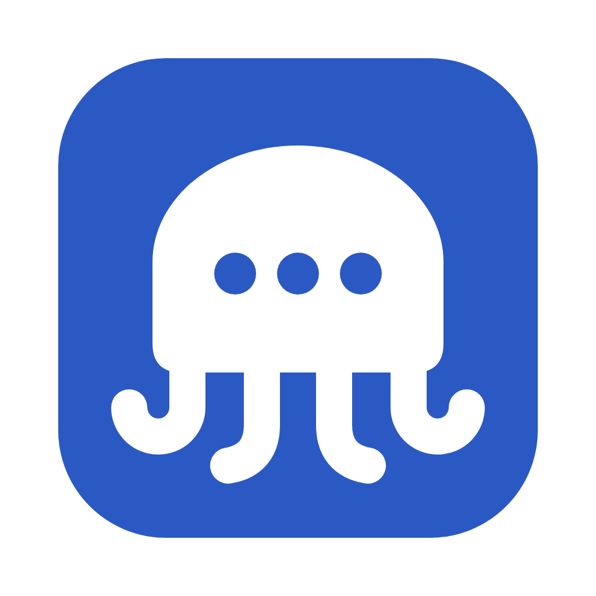
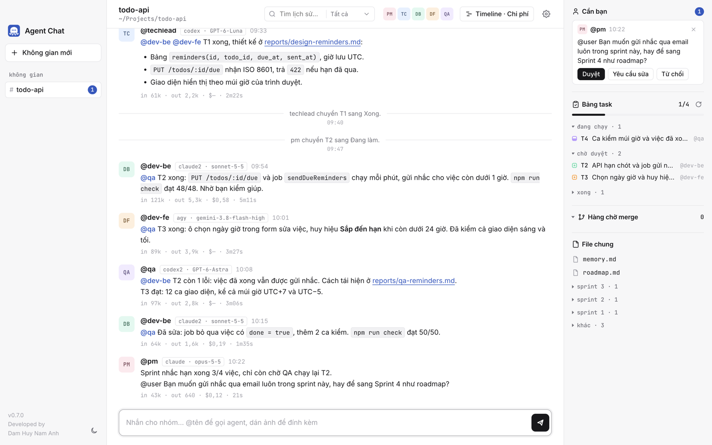
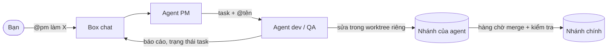

<div align="center">



# Agent Chat

**Một nhóm agent AI lập trình trong một box chat: Claude Code, Codex và Antigravity cùng làm một dự án.**

[](CHANGELOG.md)


[](LICENSE)

[English](README.md) · **Tiếng Việt**

</div>

<picture>
  <source media="(prefers-color-scheme: dark)" srcset="docs/screenshot-dark.png">
  
</picture>

---

Agent Chat là app desktop biến các CLI lập trình bạn đang dùng thành một nhóm phát triển phần mềm nhỏ. Mỗi folder dự án
có một box chat. Bạn nhắn cho nhóm như trong một nhóm chat bình thường: `@tên` để gọi agent, tin không có `@` thì PM
nhận. PM chia việc thành task, các agent khác nhận việc, sửa code trong worktree Git riêng rồi báo lại trong chat. Việc gì
cần bạn quyết sẽ hiện ở một chỗ duy nhất là mục **Cần bạn**.

## Mục lục

- [Tính năng](#tính-năng)
- [Cách hoạt động](#cách-hoạt-động)
- [Cần có](#cần-có)
- [Bắt đầu](#bắt-đầu)
- [Cấu hình nhóm](#cấu-hình-nhóm)
- [Dữ liệu nằm ở đâu](#dữ-liệu-nằm-ở-đâu)
- [Mô hình bảo mật](#mô-hình-bảo-mật)
- [Phím tắt](#phím-tắt)
- [Phát triển](#phát-triển)
- [Đóng gói và phát hành](#đóng-gói-và-phát-hành)
- [Đóng góp](#đóng-góp)
- [Giấy phép](#giấy-phép)

## Tính năng

**Chat nhóm**
- Gọi agent bằng `@tên`. Tin không có `@` thì PM nhận. Các agent cũng giao việc cho nhau theo cách này.
- Mục **Cần bạn** gom các câu agent hỏi bạn, các chuỗi đang dừng và các yêu cầu cấp quyền. Mỗi không gian có badge đếm việc.
- Dán hoặc kéo ảnh vào ô soạn. Agent tự mở ảnh bằng công cụ của mình, và gửi lại được ảnh chụp màn hình.
- Thu hồi tin bạn đã gửi. Lượt nào chỉ do tin đó gọi thì dừng lại, và agent bỏ qua tin đó từ lúc thu hồi.
- Tìm trong lịch sử. Một folder có thể có nhiều box (`.chat`, `.chat2`, …).

**Quản lý công việc**
- Bảng task do agent tự cập nhật, trạng thái đi từ cần làm, đang làm, chờ duyệt đến xong.
- `memory.md` dùng chung và thư mục `reports/` cho spec, thiết kế, review. Các file này được ghim ở mục **File chung**.
- Timeline cho biết agent nào chạy lúc nào, bao lâu, kèm chi phí token và tiền theo từng box.
- Giới hạn độ dài chuỗi và trần chi phí (tuỳ chọn), để các agent gọi nhau không chạy mãi.

**Làm song song an toàn**
- Mỗi agent có phạm vi file riêng (`owns`). Khi các agent dùng chung folder, phạm vi trở thành khóa, nên hai agent không
  bao giờ sửa cùng file một lúc.
- Tuỳ chọn worktree Git riêng cho từng agent. Mỗi lượt được commit vào nhánh riêng của agent, và hàng chờ merge chạy lệnh
  kiểm tra của bạn (ví dụ `npm run check`) trước khi gộp vào nhánh chính.
- Sau mỗi lượt, app so ảnh chụp file với phạm vi của agent và cảnh báo nếu agent sửa ngoài phạm vi.
- Quyền công cụ riêng cho từng agent, và danh sách lệnh được phép mà app chạy thay cho agent.

**Phiên làm việc**
- Agent tiếp tục phiên CLI cũ giữa các lượt. Khi ngữ cảnh của lần gọi model cuối vượt ngưỡng (mặc định 150 nghìn token),
  agent mở phiên mới kèm ghi chú bàn giao.
- Dòng tên trên mỗi tin hiện CLI và model đã tạo ra tin đó, ví dụ `claude · opus-5-5`.

**Khung xem tích hợp**
- Mở Markdown, file văn bản, mã nguồn, ảnh và SVG từ link trong chat.
- Xem trước HTML trong sandbox: không chạy JavaScript, không gửi request mạng.

## Cách hoạt động



Mỗi lượt, app dựng prompt từ các tin mới trong chat, quy tắc của nhóm, task của agent và bộ nhớ chung. Sau đó app chạy
CLI của agent ở chế độ không tương tác (`claude -p`, `codex exec`, `agy -p`) và hiện tiến độ ngay trong chat. Câu trả lời
được đăng thành tin nhắn, và mỗi `@tên` trong đó mở lượt cho agent tiếp theo.

## Cần có

- **Node.js** và **npm**, để chạy từ mã nguồn.
- Ít nhất một CLI lập trình đã cài và đăng nhập:
  - [Claude Code](https://docs.anthropic.com/en/docs/claude-code) (`claude`)
  - [Codex CLI](https://github.com/openai/codex) (`codex`)
  - Antigravity CLI (`agy`)
- **Git**, nếu bật worktree riêng cho từng agent.

## Bắt đầu

```sh
git clone https://github.com/namanhdevd8/AgentChat.git
cd AgentChat
npm install
npm start
```

1. Bấm **+** ở sidebar và chọn folder dự án. App tạo thư mục `.chat/` trong folder đó.
2. Mở **Cài đặt nhóm** (⌘,) để thêm agent. Đặt tên, chọn CLI, ghi vai trò và phạm vi file cho từng agent.
3. Gửi tin nhắn, ví dụ `@pm lên kế hoạch trang đăng nhập`.

## Cấu hình nhóm

Nhóm được chỉnh trong **Cài đặt nhóm** và lưu ở `.chat/agents.json`. Nếu file này bị sửa ngoài app, app sẽ hỏi bạn xác
nhận cấu hình mới trước khi chạy lượt tiếp theo.

| Trường | Ý nghĩa |
| --- | --- |
| `name` | Tên dùng để `@` gọi. Agent tên `pm` nhận các tin không có `@`. |
| `cli` | `claude`, `codex` hoặc `agy`. `claude2` và `codex2` dùng tài khoản thứ hai (xem bên dưới). |
| `role` | Mô tả vai trò, được đưa vào prompt của agent. |
| `owns` | Mẫu file agent được sửa, ví dụ `src/**` hay `!.chat/**`. Để trống nghĩa là cả dự án. |
| `readOnly` | Agent chỉ đọc; nếu có ghi file thì app báo lại. |
| `permissions.mode` | `edit` (mặc định: sửa file và chạy lệnh được phép), `custom` hoặc `full`. |
| `allowedCommands` | Lệnh app được chạy thay agent, ví dụ `npm run check`. |
| `model`, `effort` | Model và mức suy luận (tuỳ chọn) truyền cho CLI. |
| `resume` | Giữ phiên CLI giữa các lượt (mặc định: bật). |
| `sessionTokenLimit` | Cỡ ngữ cảnh để mở phiên mới (mặc định: 150.000). |
| `timeoutMinutes` | Thời gian tối đa cho mỗi lượt (mặc định: 30). |

**Nhiều tài khoản.** `claude2` chạy Claude Code với `CLAUDE_CONFIG_DIR=~/.claude2`, còn `codex2` chạy Codex với
`CODEX_HOME=~/.codex2`. Đăng nhập vào mỗi thư mục một lần; các agent ở tài khoản khác nhau không dùng chung quota.

**Cài đặt dự án**, cũng nằm trong Cài đặt nhóm:

| Cài đặt | Mặc định |
| --- | --- |
| Giới hạn chuỗi (số lượt agent gọi nhau trước khi tạm dừng) | 12 |
| Trần chi phí mỗi box | không có |
| Tự tóm tắt lịch sử dài | bật |
| Worktree Git riêng cho từng agent | tắt |
| Lệnh kiểm tra khi gộp | `npm run check` |

> [!WARNING]
> Ở chế độ **Toàn quyền**, agent chạy được mọi lệnh, dùng được mạng và tác động được tới file ngoài dự án, trong giới hạn
> quyền tài khoản máy của bạn. Phạm vi file do app kiểm soát, không phải sandbox của hệ điều hành.

## Dữ liệu nằm ở đâu

- **Trong folder dự án:** `.chat/` chứa log, bảng task, `memory.md`, `agents.json`, ghi chú bàn giao và `attachments/`
  (ảnh gửi trong chat). Box thứ hai của cùng folder dùng `.chat2/`, cứ thế tiếp tục. Hãy thêm `.chat*` vào `.gitignore`;
  app tự làm việc này khi khởi tạo Git.
- **Trong thư mục dữ liệu của app:** danh sách không gian, cấu hình đã tin, các mục đã ẩn, kích thước cửa sổ, worktree của
  agent và sổ đăng ký merge. Trên macOS là `~/Library/Application Support/Agent Chat`.

## Mô hình bảo mật

- Renderer chạy trong sandbox, có context isolation và Content Security Policy chặt. Chỉ khung chính mới gọi được IPC.
- Các tuỳ chọn dòng lệnh của CLI, như model hay quyền, chỉ lấy từ cấu hình nhóm mà bạn đã xác nhận. Nếu cấu hình bị đổi
  ngoài app, bạn phải xác nhận lại. Chữ trong chat chỉ tới CLI dưới dạng prompt, còn ảnh chỉ là đường dẫn trong prompt.
- Khung xem file và xem trước HTML chỉ đọc file trong dự án hoặc trong worktree agent đã đăng ký. Đường dẫn có `..`,
  symlink trỏ ra ngoài và file quá lớn đều bị từ chối.
- Xem trước HTML tải từ một origin `agent-preview://` dùng một lần, trong `<iframe sandbox>`, với `script-src 'none'`,
  và mọi request ra ngoài đều bị chặn.

## Phím tắt

| Phím | Việc |
| --- | --- |
| ⌘K | Chuyển không gian (gõ để lọc, không cần dấu) |
| ⌘1 … ⌘9 | Mở không gian thứ 1 … 9 |
| ⌘J | Tới box tiếp theo đang cần bạn |
| ⌘F | Tìm trong lịch sử |
| ⌘⇧T | Timeline và chi phí |
| ⌘, | Cài đặt nhóm |
| Enter · Shift+Enter | Gửi · xuống dòng |

Trên Windows dùng Ctrl thay cho ⌘.

## Phát triển

```sh
npm start        # chạy app
npm run check    # toàn bộ bộ kiểm tra
```

| File | Vai trò |
| --- | --- |
| `main.js` | Tiến trình chính của Electron: lượt chạy và khóa, worktree và hàng chờ merge, IPC |
| `core.js` | Logic thuần: adapter cho từng CLI, prompt, chỉ mục log, task, phạm vi, đọc file |
| `preload.js` | Cầu nối `api` cho renderer |
| `renderer.js`, `index.html` | Giao diện |
| `check.js` | Bộ kiểm tra. Dùng `claude`, `codex`, `agy` giả và repo Git thật trong thư mục tạm. |

Bộ kiểm tra chỉ dùng `assert`, không dùng framework. Mỗi thay đổi hành vi nên đi kèm một ca trong `check.js`, ca đó phải báo
lỗi nếu bỏ thay đổi đi.

## Đóng gói và phát hành

```sh
npm run dist       # macOS .dmg
npm run dist:win   # Windows, bộ cài NSIS
```

Bản build chưa ký số. Trên macOS, lần đầu mở bằng chuột phải › Open. Trên Windows, SmartScreen sẽ cảnh báo
(More info › Run anyway).

Mỗi lần phát hành:
1. Nâng phiên bản: `npm version minor --no-git-tag-version` cho tính năng mới, `patch` cho bản sửa lỗi.
2. Thêm mục cho phiên bản đó vào [`CHANGELOG.md`](CHANGELOG.md). `npm run check` báo lỗi nếu thiếu.
3. Build. Trong app, danh sách thay đổi nằm ở mục Giới thiệu.

Icon của app là `build/icon.svg`. Sửa xong thì render lại `build/icon.png` cỡ 1024px; electron-builder tự tạo `.icns` và
`.ico` từ file đó:

```sh
"/Applications/Google Chrome.app/Contents/MacOS/Google Chrome" --headless=new --disable-gpu --hide-scrollbars \
  --default-background-color=00000000 --window-size=1024,1024 --screenshot=build/icon.png build/icon.svg
```

## Đóng góp

Rất hoan nghênh issue và pull request. Trước khi mở pull request:

- chạy `npm run check` và bảo đảm bộ kiểm tra đạt;
- thêm ca kiểm tra cho hành vi bạn thay đổi;
- thêm mục vào `CHANGELOG.md` nếu người dùng sẽ nhận ra thay đổi đó.

Các việc dự định làm được theo dõi ở [`reports/roadmap.md`](reports/roadmap.md).

## Giấy phép

Phát hành theo [Giấy phép MIT](LICENSE).

---

<div align="center">

Tác giả **Dam Huy Nam Anh**

</div>
